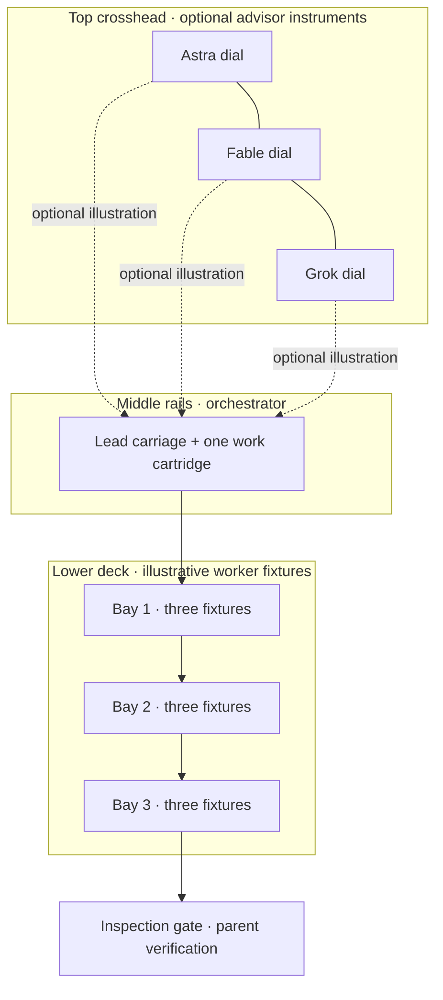

# AgentSmith workbench figure

## Concept and decision

A compact mechanical analogy places optional advisor instruments on the top crosshead, one lead/orchestrator carriage on the middle travel rails, and grouped worker fixtures in three bays on the lower deck. The single illuminated work cartridge rides with the carriage from bay to bay. It returns to a mechanical inspection gate that represents parent verification. The role names and controls sit in the surrounding card and legend, not on the machine.

**Observable behavior:** pointer and keyboard controls step the carriage through three task returns; the count changes only as each illustrated result returns. The inspection gate accepts verification only after all three results have returned. The same pure model drives pose, phase, count, advisor toggles, accessible status, and the idle tour.

**Non-goals and truth limits:** this is an interactive illustration, not live telemetry, a session monitor, an agent-capacity measurement, or a runtime/configuration control. The three dials illustrate optional advisor roles; the three worker bays and their three fixture sockets each are an illustrative pool, not a concurrency limit. No role label is engraved on the object; the single engraving is the machine nameplate.

**Deciding constraints:** retain the existing 40 to 80 purposeful-part range, fit a 390 px viewport without horizontal overflow, preserve dark and light themes, and use only the vendored Anatomy MIT closure. Keep controls and legend outside the physical object.

**Chosen trade-off:** one traversing carriage keeps the workflow legible while the repeated lower fixtures make a swarm visually recognizable. A non-moving diagram would be simpler but would not demonstrate routing, returns, or the verification boundary.

**Plausible failure and seam check:** the stacked hierarchy could read as three separate machines or the sockets as measured worker capacity. Keep the three upper dials visibly on one shared crosshead, the lead carriage centered on one shared pair of rails, and all nine lower fixtures in three grouped bays; state the illustration/capacity caveat adjacent to the figure. Coordinator browser verification covers a 390 px viewport; other embedding widths need separate review.

**Measured viewport:** coordinator verification measured the workbench at 674.015625 px high at 390 × 844. This single viewport does not establish stage height at other sizes; do not infer actual agent activity from its animation.

## Actual physical inventory: finalized from geometry.mjs

The scene defines 71 named physical parts in `geometry.mjs`. Fine ticks, screw slots, seams, and the nameplate engraving are surface details, not extra parts.

### Bed and mounting (12)

1. Heavy beveled bedplate.
2 to 5. Four leveling feet.
6. Front retaining lip.
7. Rear retaining lip.
8. Engraved machine nameplate.
9 to 12. Four bed fasteners.

### Frame and travel system (10)

13. Left gantry upright.
14. Right gantry upright.
15. Shared upper advisor crosshead.
16. Front travel rail.
17. Rear travel rail.
18. Left rail mount.
19. Right rail mount.
20. Left end stop.
21. Right end stop.
22. Ruler strip with rooted ticks.

### Lead carriage and cartridge probe (13)

23. Lead/orchestrator carriage body.
24. Front bearing housing.
25. Rear bearing housing.
26. Front bearing retainer.
27. Rear bearing retainer.
28. Thumb screw.
29. Knurled handwheel.
30. Cartridge cradle.
31. Single illuminated work cartridge.
32. Cartridge retaining latch.
33. Probe housing.
34. One probe rod.
35. Probe tip.

### Lower worker bays (18)

36. Left bay deck.
37. Left front jaw.
38. Left rear jaw.
39 to 41. Three worker-fixture sockets in the left bay.
42. Middle bay deck.
43. Middle front jaw.
44. Middle rear jaw.
45 to 47. Three worker-fixture sockets in the middle bay.
48. Right bay deck.
49. Right front jaw.
50. Right rear jaw.
51 to 53. Three worker-fixture sockets in the right bay.

### Top advisor instruments (12)

54 to 56. Three instrument housings.
57 to 59. Three bezels.
60 to 62. Three dial faces.
63 to 65. Three needles.

### Inspection gate (6)

66. Left gate post.
67. Right gate post.
68. Gate crosshead.
69. Moving gate stop.
70. Gate spring.
71. Calibration knob.

## Geometry correction note

Earlier audits exposed ungrounded moving bearings, cycles from overlapping annular parts, a spring endpoint not tangent to its support face, a tight coil that folded in projection, and a gate bridge intersecting the inspection payload. The carriage now rides on two flat prismatic `A.slab` ways (figure-scale z=74 to 82); bearing shoes rest on those tops, retainer plates sit on the shoes, and the carriage body rests on the retainers. The gate posts are outboard at y=±42, outside the carriage body’s y=±36 edges; its bridge spans z=106 to 112, above the carriage’s highest z=102 hardware (body top z=98). The stop and calibration knob sit above that bridge. The return spring is a broad, smooth bowed wire route spanning the two gate-post inner faces, with end tangents along that span. The carriage seam reaches both body edges. All dimensions are figure-scale, not real hardware measurements.

The stage viewBox is 960 × 700 to reduce unused horizontal area without cropping the physical bounds. The light theme uses darker metal tones, and its amber workpiece rule targets the emitted `#machine-svg > #machine-parts > .machine-item[data-part="work-cartridge"] > .iso-solid[data-lit]` hierarchy.

## Verification and limits

**Current coordinator verification:** A real Brave run at 390 × 844 waited for all 71 rendered items and the runtime carriage transform. All six measured button/input rectangles were within the rendered workbench. The document width and scroll width were both 390 px; the workbench measured 674.015625 px tall. This is one viewport and one measured control set, not proof for all devices or embeds.

**Pause and resume:** A read-only wrapper forwarded native `requestAnimationFrame` and `IntersectionObserver` callbacks. The wrapper moved `#workbench`, the element observed by the runtime, offscreen. Animation callbacks were zero during a 250 ms sample and the carriage pose was unchanged; returning the workbench onscreen resumed animation. Home restored the exact initial phase, count, and pose. Console was clean. The earlier probe moved `#machine-stage`, so it did not test the observed workbench and is not evidence of a product defect. The final reset comparison was corrected to use the observed initial state.

**VERIFIED geometry checks for the optional-demo stack:** Dark and light `node site/anatomy/build.mjs --audit` runs each sampled 16 poses and returned 16 passed, 0 failed, with zero audit findings. The samples cover the staged pose, left/center/right routes, inspection, and the verified gate at selected frames and rest positions. These finite samples do not establish continuous motion, real-hardware behavior, or every renderer.

**VERIFIED integration checks:** The combined Node model/viewer suite returned 9 passed, 0 failed; Python returned 28 tests and `OK`. Two missing-theme controls failed against the map-only builder and passed against the demo builder, which preserved existing output. Real Brave reached all six pages at desktop and phone widths. All four disclosures started closed and loaded their same-origin iframe when opened. The HTTP probe returned 200 for 18 resources; both generated themes retained the complete MIT notice. Automated accessibility auditing remains unverified.

These checks do not change the non-goals above: no live telemetry, session monitoring, capacity measurement, or runtime/configuration control. The pinned five-file Anatomy MIT closure and its provenance follow.

## Provenance record

The four-module-plus-license closure is pinned to <https://github.com/wheresryan22/anatomy/tree/7895e19d2d8d9b585283b6113e25fc091275f0cc>. This verification covers only `iso-kit.mjs`, `lathe.mjs`, `tube.mjs`, `audit.mjs`, and `LICENSE`, not the full upstream repository. The verified upstream Git blob IDs are: `iso-kit.mjs` 248ee01cc00dfaeee9d693f49f63e32913f03115; `lathe.mjs` b2fb74dfda69aa6296152d76ec70f314ce2955f1; `tube.mjs` 94d1c84a7b7a1d1b1000de9ae3c84f53d093901a; `audit.mjs` 126ec0d83252db3415f32d35acd16567c53dad2d; `LICENSE` aa20733917ffc919b6b04834e6a6e22909df7c76.

The vendored five-file closure matches the pinned public revision. Its SHA-256 values are:

- `vendor/iso-kit.mjs`: `6d3ecc725d30c3b0346da309cf61dfa5a65017c23620bbd4093009d4fb104018`
- `vendor/lathe.mjs`: `a4e7e974b1a37e603ad2b76363b6f9815cc101dfff0ad277a5d4e8f1dc56fccb`
- `vendor/tube.mjs`: `bcb3cc360f6d83e6a5753f4c464b4587ab7965028b05a5d58e285abce58667c9`
- `vendor/audit.mjs`: `90c5bb4a86f108e8a1d3211dbea326bed16acd887c3438810ea29200a2cde28d`
- `vendor/LICENSE`: `87c078ab9d90a3044f359e6b563d4e6afea7aa060897cf4f21618687b3856796`

The complete upstream MIT license, copyright (c) 2026 Ryan, is retained at `site/anatomy/vendor/LICENSE` and included in generated HTML.

## Optional static-site illustration design

The workbench is an optional static-site illustration with authored motion. Its state comes from the illustration model and controls; it is not connected to a running Agentsmith session. The optional drawing supplements the map pages and never replaces their flowcharts. Rules keeps `approval-flow`, Workflows keeps `worker-farms`, and OMP and Architecture keep `whole-architecture`.

The metaphor is deliberately literal: optional advisor instruments share one crosshead, a single lead carriage carries the work cartridge between grouped worker bays, and a return to the inspection gate represents parent verification. These forms are visual cues only. The drawing does not explain the system architecture, show live telemetry, provide provider access, or measure worker capacity.

The interface is optional and its disclosures start closed. Both generated themes have full-size links. Optional describes the UI, not the build inputs: Node generates `workbench.html` and `workbench-light.html`; the site builder reads both views with its other inputs before changing `_site`, then copies only these views under `_site/anatomy`.

### Least confident decisions

1. INFERRED: The machinery metaphor is a useful visual supplement, but it has no usability evidence and should not be mistaken for the flowcharts.
2. INFERRED: Closed disclosures keep the maps first while leaving the drawing discoverable; whether contributors notice or open them remains untested.
