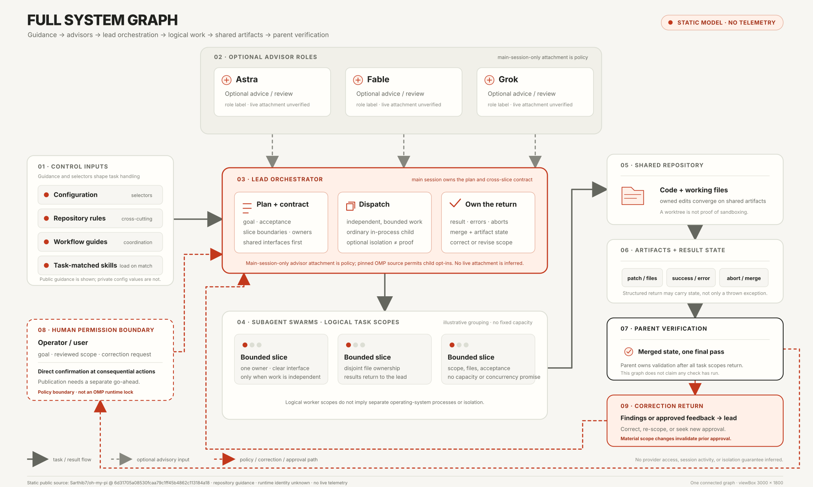
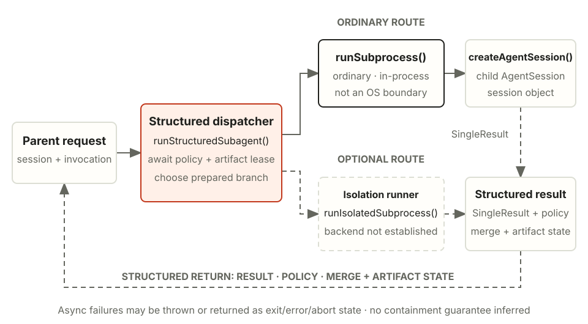
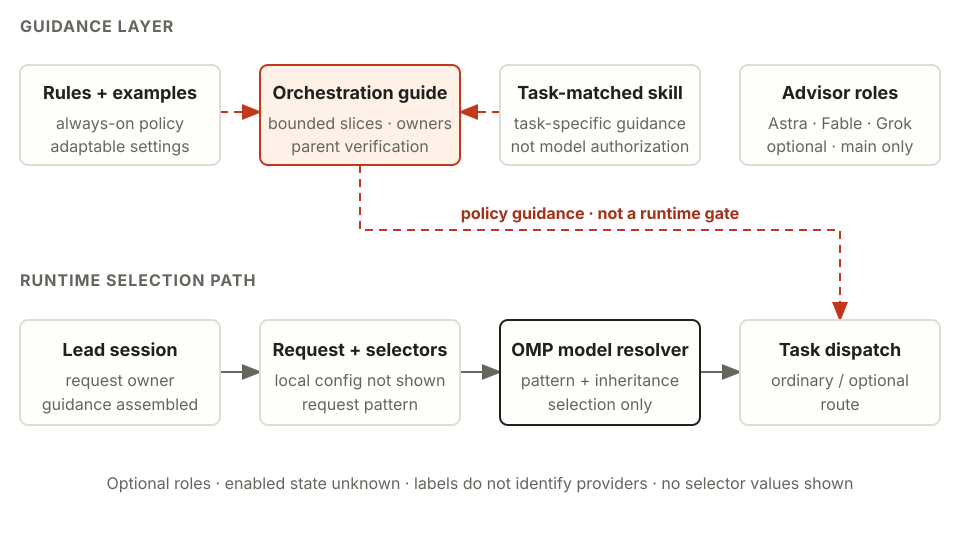
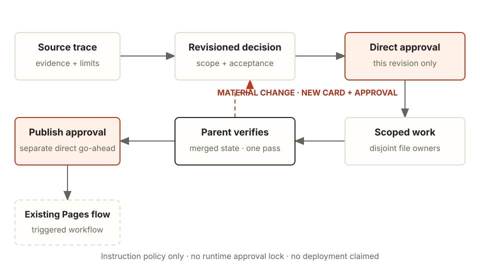
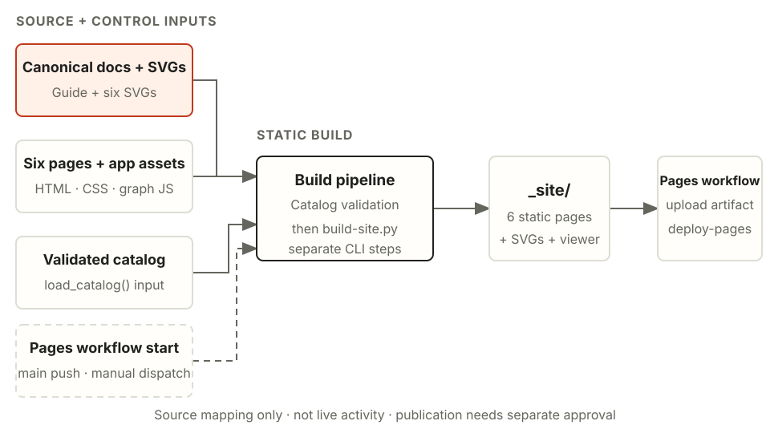

# Agentsmith architecture

This guide records the documented workflow, static-site build path, and a source trace of Oh My Pi (OMP) task dispatch. It separates source behavior from policy and unknown runtime state. Every OMP code link below is pinned to public commit 6d31705a08530fcaa79c1ff45b4862c113184a18. Treat these sections as static source analysis, not a report of an installed runtime or running session.

**Evidence labels:** *Source* means the cited code or repository guide states the behavior. *Policy* means a documented operating rule. *Unknown* means the inspected public material cannot establish the fact.

## Overview

[Open the full-size whole-system SVG (3000 × 1800; 5:3)](diagrams/whole-architecture.svg).

The Architecture page's read-only SVG viewer starts with a contain-fit of the whole graph, recalculates on resize and fullscreen, and keeps the visible area in a pointer-inert minimap sourced from the same SVG. Buttons or keyboard zoom about the viewport center; Ctrl/Meta+wheel zooms at the pointer; drag pans, pinch zooms and pans, and arrow keys pan. <code>Fit all</code> and <code>0</code> show the entire graph; <code>100%</code> means one CSS pixel per SVG unit. Interactive zoom adjustments clamp from 2% to 400%; an unusually small viewport may require a smaller fit to keep every node and edge visible, and labels are naturally smaller at full-graph scale. The minimap shows the clipped visible-world rectangle, not running work, model activity, or telemetry. The viewer is read-only and has no automatic camera movement.
At <code>Fit all</code>, resize and fullscreen keep the full graph fitted; zoomed views preserve fit-relative magnification and the world point at the viewport center.
Wheel input without Ctrl/Meta continues to scroll the page. The interaction pattern follows React Flow's <code>fitView</code>, <code>Controls</code>, and <code>MiniMap</code> concepts ([API reference](https://reactflow.dev/api-reference)) but uses this native, non-editable SVG viewer; no React Flow runtime or React framework is added.

This topology view is a static source model, not live runtime telemetry.

A human gives the goal to a lead session. The lead owns the plan and cross-slice contracts, delegates only independent bounded slices, and assigns one owner per file. Work results and repository artifacts flow back to the lead for verification on the merged state. This follows the [orchestration guide](../workflows/orchestration.md#L7-L34) and its [work pattern](../workflows/orchestration.md#L56-L61). The worker farm is a logical batch of task scopes, not a separately installed product or a guarantee of one operating-system process per worker.

The public advisor examples use the optional role labels Astra, Fable, and Grok. Their enabled state and session bindings are unknown here. Project policy attaches advisors to the main session only. The executor source also permits per-agent advisor opt-ins, so capability and policy are distinct ([policy](../workflows/orchestration.md#L52-L55), [executor capability](https://github.com/Sarthib7/oh-my-pi/blob/6d31705a08530fcaa79c1ff45b4862c113184a18/packages/coding-agent/src/task/executor.ts#L3315-L3335)). Role labels do not identify a provider, prove access, or show that an advisor ran.

## Workers

**Source trace.** In the pinned OMP source, <code>runStructuredSubagent()</code> resolves effective policy, leases artifacts, prepares options, and chooses between the ordinary and optional isolation branches. The ordinary route calls <code>runSubprocess()</code>; the executor comment explicitly describes this as in-process and the path creates an <code>AgentSession</code> ([dispatcher](https://github.com/Sarthib7/oh-my-pi/blob/6d31705a08530fcaa79c1ff45b4862c113184a18/packages/coding-agent/src/task/structured-subagent.ts#L604-L716), [in-process comment](https://github.com/Sarthib7/oh-my-pi/blob/6d31705a08530fcaa79c1ff45b4862c113184a18/packages/coding-agent/src/task/executor.ts#L3258-L3261), [session creation](https://github.com/Sarthib7/oh-my-pi/blob/6d31705a08530fcaa79c1ff45b4862c113184a18/packages/coding-agent/src/task/executor.ts#L3829-L3838)). A child session is not evidence of a separate operating-system process. The optional isolation branch is selected only after an isolation context is prepared; dispatching to that branch does not establish its backend or any containment guarantee.

**Async and failure boundaries.** Dispatch awaits policy resolution, artifact leasing, optional plan/context preparation, and the chosen execution branch. Isolation-context preparation can raise a structured isolation error; existing structured errors are rethrown and other exceptions are wrapped as execution errors. Child startup is abortable: if abort wins while session creation is pending, a late-created session is disposed before the abort is rethrown. A returned <code>SingleResult</code> can itself carry a nonzero exit, an error, or an abort, so failure is not limited to thrown exceptions. The structured return also carries policy, merge summary, applied-change state, and artifact metadata. Isolated changes are merged only when the policy and apply request allow it and the result has no nonzero exit, error, or abort. Temporary artifacts are cleaned up unless detached or retained for recovery/caller policy ([dispatch and result handling](https://github.com/Sarthib7/oh-my-pi/blob/6d31705a08530fcaa79c1ff45b4862c113184a18/packages/coding-agent/src/task/structured-subagent.ts#L604-L748), [abortable session startup](https://github.com/Sarthib7/oh-my-pi/blob/6d31705a08530fcaa79c1ff45b4862c113184a18/packages/coding-agent/src/task/executor.ts#L3829-L3838)). These statements describe source paths only; they do not claim that a task was executed.

## Configuration

The repository deliberately separates three kinds of guidance: [rules](../rules/README.md#L3-L5) apply across messages, [workflows](../workflows/orchestration.md#L5-L11) describe work-specific coordination, and skills load when a task matches. The orchestration reference says to settle contracts before delegating, keep parallel slices independent, assign file ownership, and validate once on the merged state ([delegation rules](../workflows/orchestration.md#L29-L34), [work pattern](../workflows/orchestration.md#L56-L61)). Public example settings are adaptable snapshots, not proof of live settings; this guide does not reproduce model IDs, provider values, credentials, or local permission settings.

At runtime, the pinned model-resolver.ts considers the request pattern, settings override, agent pattern, and inherited/active/fallback/default patterns when resolving a model selection ([resolver](https://github.com/Sarthib7/oh-my-pi/blob/6d31705a08530fcaa79c1ff45b4862c113184a18/packages/coding-agent/src/config/model-resolver.ts#L1215-L1265)). A selected pattern is not authorization, subscription entitlement, usable credentials, proof of a selected backend, or evidence of live use. Likewise, an advisor role name is a label, not a provider identity. The main-session-only advisor boundary is policy; child opt-ins remain an implementation capability ([executor source](https://github.com/Sarthib7/oh-my-pi/blob/6d31705a08530fcaa79c1ff45b4862c113184a18/packages/coding-agent/src/task/executor.ts#L3315-L3335)).

## Approvals

**Policy boundary.** Approval applies to a specific reviewed scope and revision. Source evidence and limits are written down first; a direct approval authorizes only that bounded change. Parallel work uses disjoint ownership, and the parent verifies the merged result. A material change to scope or assumptions invalidates the earlier approval and requires a new decision before continuing. Publication is a separate decision from implementation approval.

This is an instruction and ownership policy, not an OMP runtime lock or an automated approval state machine. The repository's orchestration guide requires disjoint ownership and parent-owned validation ([delegation rules](../workflows/orchestration.md#L29-L34), [work pattern](../workflows/orchestration.md#L56-L61)); it does not turn a task brief into a machine-enforced authorization token. The Pages workflow is a build/deploy mechanism, not permission to publish a particular change.

## Publishing

<code>docs/architecture.md</code> and the six SVGs in <code>docs/diagrams/</code> are the canonical documentation sources. The static builder renders the Architecture page from the site template and copies those SVGs unchanged into <code>_site/diagrams/</code>; generated copies are output, not the editing source. The existing catalog interface validates skill metadata before the builder consumes it ([catalog contract](interfaces.md#L8-L27), [site builder](../scripts/build-site.py#L49-L97)).

The existing Pages workflow runs on a push to <code>main</code> or <code>workflow_dispatch</code>, validates the collection, builds the site, uploads <code>_site</code>, and invokes the Pages deploy action ([triggers](../.github/workflows/pages.yml#L3-L7), [job steps](../.github/workflows/pages.yml#L28-L47)). Builder file work is synchronous. Catalog or template/input errors fail the job, and the script makes no whole-build atomicity guarantee: a later filesystem failure can leave partial generated output. A local build is not publication, and this source map does not claim that the workflow ran or that a live deployment exists.

## Learnings

- A logical agent/session is not an operating-system process boundary. A worktree is an ownership boundary, not proof of sandboxing.
- A role label, configured pattern, or public example is not proof of active use, provider access, or entitlement.
- Policy can be stricter than implementation capability. Show both instead of describing policy as enforcement.
- A returned result has state: success, error, abort, merge, and artifact retention are distinct transitions. A single exception-only model hides real failure paths.
- Keep canonical source separate from generated output. The static builder and Pages workflow form a path to publication, but no local generation alone publishes it.

**Known limits.** Installed runtime identity, enabled advisors, session bindings, provider authorization, and current model use are unknown. The optional isolation branch does not establish a containment guarantee. This change adds no skills or private configuration exports.

## Sources

- [Structured subagent dispatch, OMP pinned commit](https://github.com/Sarthib7/oh-my-pi/blob/6d31705a08530fcaa79c1ff45b4862c113184a18/packages/coding-agent/src/task/structured-subagent.ts#L604-L748): policy resolution, artifact lease, branch dispatch, returned state, and cleanup paths.
- [Executor, OMP pinned commit](https://github.com/Sarthib7/oh-my-pi/blob/6d31705a08530fcaa79c1ff45b4862c113184a18/packages/coding-agent/src/task/executor.ts#L3258-L3261): ordinary route is in-process; [advisor opt-in capability](https://github.com/Sarthib7/oh-my-pi/blob/6d31705a08530fcaa79c1ff45b4862c113184a18/packages/coding-agent/src/task/executor.ts#L3315-L3335); [child session startup](https://github.com/Sarthib7/oh-my-pi/blob/6d31705a08530fcaa79c1ff45b4862c113184a18/packages/coding-agent/src/task/executor.ts#L3829-L3838).
- [Model resolver, OMP pinned commit](https://github.com/Sarthib7/oh-my-pi/blob/6d31705a08530fcaa79c1ff45b4862c113184a18/packages/coding-agent/src/config/model-resolver.ts#L1215-L1265): selector-pattern resolution only, not provider authorization.
- [Rules guide](../rules/README.md#L3-L5) and [orchestration guide](../workflows/orchestration.md#L7-L34): local guidance boundaries, typed task ownership, and parent validation policy.
- [Catalog interface](interfaces.md#L8-L27), [site builder](../scripts/build-site.py#L49-L97), and [Pages workflow](../.github/workflows/pages.yml#L3-L7): static input/build/output and current publication path.

The OMP links are immutable source anchors. They do not establish runtime behavior of an installed binary. The local repository links document the public setup and build configuration; they do not expose private local configuration or provider status.
